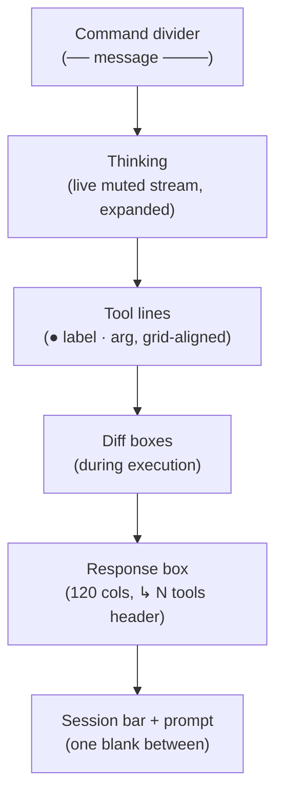

# Feature: Terminal UI (TUI)

| Field | Value |
|-------|-------|
| **Status** | `active` |
| **Delivery date** | 2026-08-25 |
| **Source spec** | `specs/2026-08-25-tui-overhaul` (Pass 1) + `specs/2026-08-25-tui-premium` (Pass 2) + `specs/2026-08-25-tui-open-boxes` (Pass 3) + `specs/2026-08-25-prompt-multiline-fix` (Pass 4) + `specs/2026-08-25-dynamic-terminal-title` + `specs/2026-08-30-reasoning-details-display` + `specs/2026-08-30-streaming-input-integrity` + `specs/2026-08-31-aligned-multiline-tool-output` + `specs/2026-09-01-turn-interrupt-queue` + `specs/2026-10-10-ui-commit-frontier` + `specs/2026-10-10-frame-transition-flicker` |
| **PRD RFs served** | RF-14, RF-16, RF-18 |
| **Owner/Area** | UI (`src/ui/`) |

---

## Description

The terminal user interface of emile: the Tokyo Night palette, boxed content, live thinking stream, input prompt, aligned multiline tool output and activity-driven terminal-tab title. The conversation has a consistent visual rhythm, while the title reports startup, waiting, thinking, responding, context compression and allowlisted tool activities even when the tab is not focused.

## How It Works

A full turn renders as a sequence of blocks, each owning one leading gap and never printing trailing blanks, which guarantees exactly one blank line between adjacent blocks:

## Technical Details

| Item | Detail |
|------|---------|
| **CLI flags** | Visual behavior only — no flags |
| **Slash commands** | `/thinking` (expand/collapse reasoning — expanded by default, opt-out collapse) |
| **Configuration** | `config.expandThinking` (`true` = expanded for both live and completed reasoning; default expanded) |
| **Reasoning request** | OpenRouter receives `reasoning: { effort }`; visible text supports `reasoning_details` while encrypted blocks remain hidden and cumulative snapshots are rendered only once |
| **Active-turn draft limit** | Input typed while a turn runs is bounded at `TURN_INPUT_MAX_CHARS` (16 000 chars). Past the cap the **oldest** characters are dropped — never the ones just pasted — with one dim notice per turn (`⚠ queued draft reached 16k chars — oldest text dropped`) and a `queued draft: N/16k` footer counter from 80% of the cap. The queued text is byte-identical to the draft apart from CRLF normalization and control-character replacement (tabs and internal spacing survive), and the queue preview marks truncation with `… (+N chars)`. The idle prompt has no such cap |
| **Thinking stream rendering** | Expanded reasoning renders **append-only** when the block cannot fit the viewport or stdout is not a TTY (unprinted suffix only, newest line kept as an open tail rewritten in place), and redraws in place only while it fits — so each fragment is emitted exactly once at any height and on pipes. Every cursor-up goes through the shared viewport clamp (`src/ui/terminal-cursor.js`) |
| **Input/redraw integrity** | The shared full prompt clips each row and preserves cursor/reset state in idle and active turns; `Shift+Enter` inserts a newline, Tab completes commands, and raw-mode ownership transfers exclusively to nested pickers or the active-turn owner, which routes stdout above the draft and keeps the real caret inside it |
| **Frame budget and elision** | `buildPromptLayout({ maxRows })` is budgeted by `stdout.rows - 1` (recomputed per render); a draft that does not fit is windowed around the cursor row with the dim markers `⌃ N earlier rows` / `⌄ N later rows`, the footer is sacrificed first and then the menu (windowed around the selection). The drawn block never exceeds `stdout.rows - 1` rows, so the erase always reaches its own top |
| **Commit frontier (finalized output)** | A closed thinking block, a finished tool grid and a completed assistant response are committed **once** through `src/ui/commit-frontier.js`: written once with a trailing newline, never repainted, a failed write left uncommitted for the next frame to retry, and committed rows that overflow the live region (`stdout.rows - 1`) released to the terminal's scrollback instead of being erased. Multi-row commits are wrapped in DEC 2026 synchronized output (`ESC[?2026h`/`l`), skipped when `$TMUX` is set or stdout is not a TTY |
| **Cursor-up clamp** | Every climb in `src/ui/` goes through `src/ui/terminal-cursor.js` and never exceeds `rows - 1`; a non-TTY stdout receives no cursor-up at all (embedded climbs report zero, exactly like `writeCursorUp`) |
| **Active-turn frame transition** | Every transition of the live frame during a turn is ONE DEC 2026 synchronized update covering erase + the agent's chunk(s) + redraw (decided once by `shouldEmitSynchronizedOutput`, so tmux and a non-TTY stdout get no marker); a burst of writes inside one event-loop turn is coalesced into a single erase and redraw; a byte-identical on-screen frame is not re-emitted; and the erase covers only the frame's own rows (`ESC[K` per row stepped with `ESC[1B` — `ESC[0J` is not emitted anywhere in `src/ui/`) |
| **Semantic tool colors** | read=info · write/edit=warn · exec=red · grep/find=gold · list=fg · plan tools=accent |
| **Multiline tool rows** | Continuation lines are sanitized, width-bounded and indented beneath the argument column instead of restarting at column zero |
| **Palette tokens** | `C.gold` (#FFD700), `C.ghost` (#3B4261); `GAP` spacing constants |
| **Terminal title** | OSC 0, activity-first, max 100 chars; real TTY only; duplicate writes suppressed |
| **Prompt lifecycle** | `persistentPromptInput` owns idle stdin; Tab completes slash commands, bracketed pasted text stays editable (including newlines) and **coalesces into a single repaint** (a burst of ≥3 text keypresses within 2 ms on terminals without bracketed paste is treated as one paste; redraws clamp their cursor-up to the viewport and skip it on non-TTY stdout), and nested pickers receive exclusive ownership. During active turns, `listenTurnKeys` provides the same paste behavior, renders the same full frame, routes stdout above it and leaves the real caret at the draft before returning ownership afterward |
| **Applicable security gates** | Assistant output sanitization; terminal title excludes prompts/command/query args and strips ANSI/OSC/control bytes |

## Where It Lives in the Code

| Layer | Main paths |
|--------|---------------------|
| Rendering | `src/ui/` module tree (`theme.js`, components and `index.js` barrel) |
| Commit frontier / frame budget | `src/ui/commit-frontier.js` (print-once finalized blocks + DEC 2026 wrapper), `src/ui/terminal-cursor.js` (single viewport clamp), `src/ui/prompt-input-persistent.js` (`buildPromptLayout({ maxRows })`, `promptFrameBudget()`) |
| Prompt interaction | `src/ui/prompt-input-persistent.js`, `src/ui/turn-keys.js`, `src/ui/switch-session.js`; lifecycle orchestration in `src/cli.js` |
| Terminal title | `src/ui/title.js`; lifecycle integration in `src/cli.js`, `src/agent/agent.js` and `src/agent/compression.js` |
| Spinner | `src/ui/spinner.js` (silent stop on success) |
| Render harness | `test-ui.js` (full simulated turn) |

## Known Limitations

- Chained-tool waiting states still use the generic spinner (no per-step progress).
- No dedicated visual treatment for API errors/model fallback yet.
- Slash commands don't open a visual "chapter" divider; interactive selects lack radio-style active/inactive treatment.
- `/cost` still renders as a loose list outside the box pattern.
- See `docs/visual-identity.md` § 5 (visual debt backlog) and the deferred items in the spec § 5.
- Terminals that ignore OSC titles receive no alternate window-manager integration; the previous shell title cannot be queried/restored portably.

## Change History

| Date | Change | Reference |
|------|---------|------------|
| 2026-08-25 | Pass 1: vertical rhythm, tools box with semantic colors, dimmed thinking, silent spinner, box padding, dim `off` states, prompt gap, `pc`→`C` consolidation | `specs/2026-08-25-tui-overhaul` / CHANGELOG |
| 2026-08-25 | Pass 2 (premium): grid-aligned tool lines replacing the tools box, ghost thinking collapsed by default, command divider for user messages, `↳ N tools` header replacing the tools-done footer, 88-column response box, gold/ghost tokens, GAP constants | `specs/2026-08-25-tui-premium` / CHANGELOG |
| 2026-08-25 | Pass 3 (open boxes): side borders removed from every box (top/bottom only), white top-border bug fixed via separately-composed ANSI parts, 4-space content indent, open-style diff block | `specs/2026-08-25-tui-open-boxes` / CHANGELOG |
| 2026-08-25 | Pass 4: prompt multiline rendering fixed (explicit per-row writes, clamped cursor column, divider echo on submit), response box measure raised to `MAX_BOX_W = 120` | `specs/2026-08-25-prompt-multiline-fix` / CHANGELOG |
| 2026-08-25 | Dynamic terminal title: automatic sanitized lifecycle, reasoning, response, compression and tool states; no model-facing tool or prompt/argument leakage | `specs/2026-08-25-dynamic-terminal-title` / CHANGELOG |
| 2026-08-30 | Reasoning display fix: unified `/thinking` state, completed duration for expanded streams, and OpenRouter `reasoning_details` parsing with encrypted-block protection | `specs/2026-08-30-reasoning-details-display` / CHANGELOG |
| 2026-08-30 | Reasoning is expanded by default after validation with `minimax-m3:free`; `/thinking` and Ctrl+P remain the collapse toggle | `specs/2026-08-30-reasoning-details-display` / CHANGELOG |
| 2026-08-31 | Streamed reasoning no longer duplicates cumulative/overlapping text; prompt and thinking redraws use atomic frames and `Shift+Enter` supports multiline input | `specs/2026-08-30-streaming-input-integrity` / CHANGELOG |
| 2026-08-31 | Multiline tool arguments keep continuation lines aligned beneath the argument column with existing styling, bounds and sanitization | `specs/2026-08-31-aligned-multiline-tool-output` / CHANGELOG |
| 2026-09-01 | Persistent prompt lifecycle: Tab completion, exact wrapped cursor/reset state, exclusive nested-picker stdin and reliable resume after `/switch` | `specs/2026-09-01-turn-interrupt-queue` / CHANGELOG |
| 2026-09-02 | Active-turn visual parity: shared full prompt, distinct `●` autocomplete selection, prompt-aware stdout arbitration and real caret preserved at the draft | `specs/2026-09-01-turn-interrupt-queue` / ADR-0003 |
| 2026-10-09 | Large-paste duplication fixed: a paste (bracketed or a ≥3-keypress burst within 2 ms) repaints the prompt block **once** instead of per character, and every cursor-up is clamped to `stdout.rows - 1` and suppressed entirely on a non-TTY stdout | `specs/2026-10-09-paste-burst-redraw` / CHANGELOG |
| 2026-10-10 | Active-turn input no longer truncates silently: the draft cap moved from 400 to 16 000 chars, the oldest characters are dropped instead of the newest (one visible notice per turn), the footer shows a draft counter past 80%, the queue preview carries a `(+N chars)` marker, and `sanitizeLine` stopped collapsing whitespace and stripping tabs | `specs/2026-10-10-turn-input-cap` / CHANGELOG |
| 2026-10-10 | Live thinking stream is **append-only** once the block cannot fit (or stdout is not a TTY): only the unprinted suffix is emitted and the newest line is kept as an open tail rewritten in place, so a thought is rendered exactly once at any viewport height and on pipes; a fitting stream still redraws in place with a clamped climb. The shared viewport clamp moved to `src/ui/terminal-cursor.js` | `specs/2026-10-10-thinking-append-only` / CHANGELOG |
| 2026-10-09 | Large-paste duplication fixed: a paste (bracketed or a ≥3-keypress burst within 2 ms) repaints the prompt block **once** instead of per character, and every cursor-up is clamped to `stdout.rows - 1` and suppressed entirely on a non-TTY stdout, so height overflow degrades to scrolling rather than duplicated frames | `specs/2026-10-09-paste-burst-redraw` / CHANGELOG |
| 2026-10-10 | **No flicker while streaming** (P1-16): the active-turn frame transition is ONE synchronized update (erase + agent chunk(s) + redraw) instead of three writes per agent write, a burst of writes in one event-loop turn is coalesced into a single erase/redraw, an unchanged on-screen frame is not re-emitted, and `ESC[0J` left the whole `src/ui/` — the erase now walks only the frame's own rows. The row reservation became a proof of in-place redraw instead of a caret-relative estimate | `specs/2026-10-10-frame-transition-flicker` / CHANGELOG |
| 2026-10-10 | Output commit frontier + viewport-budgeted prompt frame (P1-14 Stage A, subsuming P2-18 and P2-19): `src/ui/commit-frontier.js` makes a finalized block print-once (a failed write stays uncommitted and is retried, overflow is released to the scrollback, multi-row writes are wrapped in DEC 2026 except under tmux) and the closed thinking block, finished tool grid and completed response go through it; `buildPromptLayout({ maxRows })` is budgeted by `stdout.rows - 1` — a draft that does not fit is windowed around the cursor with the dim `⌃ N earlier rows` / `⌄ N later rows` markers, so an erase can always reach its own top; the remaining unclamped climbs (`turn-keys`, `model-picker`, `prompt-input`) now go through `src/ui/terminal-cursor.js` and a non-TTY stdout receives no cursor-up at all | `specs/2026-10-10-ui-commit-frontier` / CHANGELOG |
